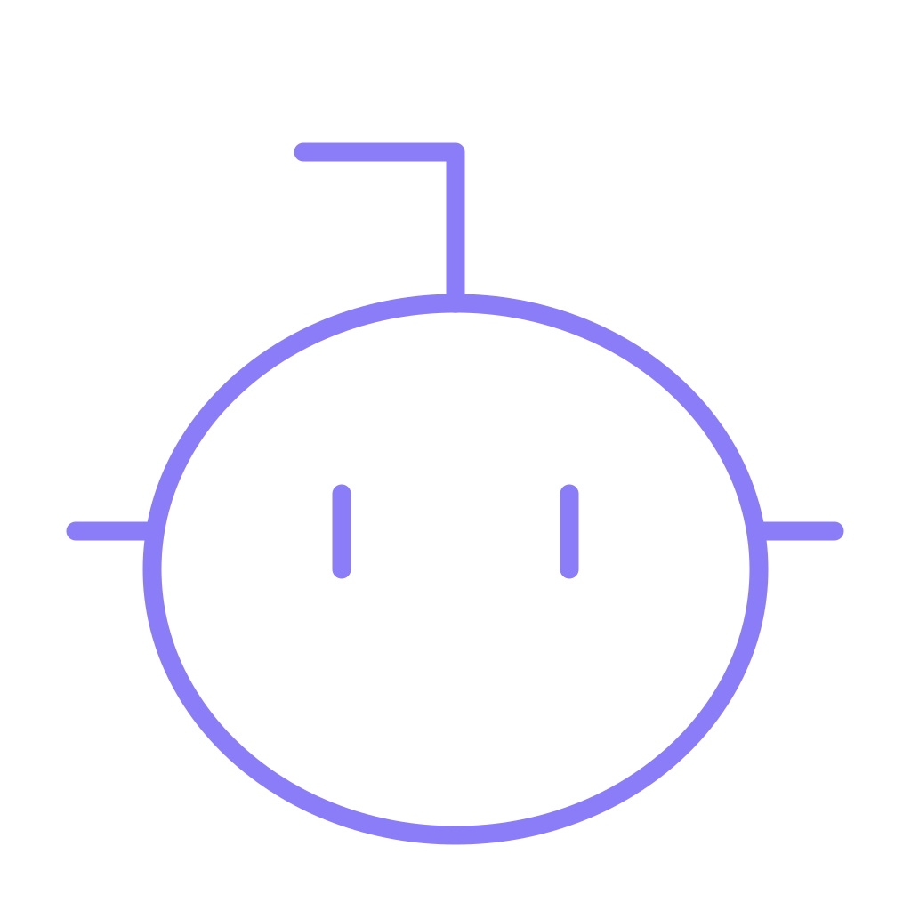
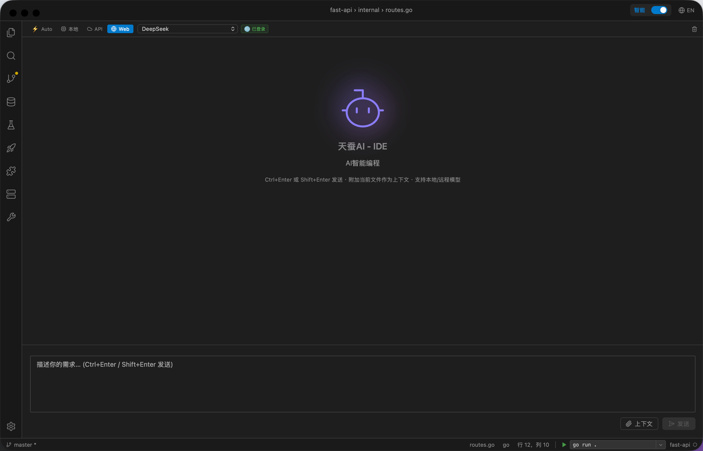
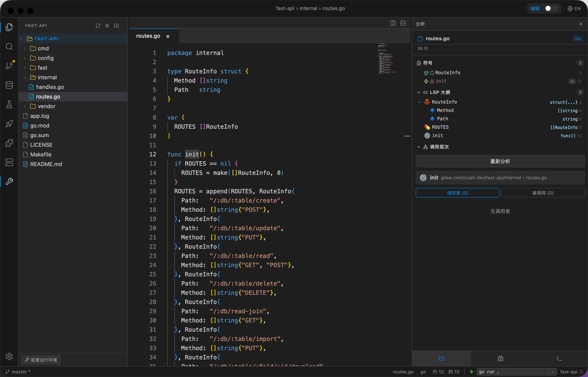

<div align="center">
  
  <h1>天蚕 · TianCan AI IDE</h1>
  <p>纯本地、跨平台（Windows / macOS / Linux）的 AI 编程 IDE<br/>
  无需云端 API，无需订阅，所有 AI 推理均在本地硬件运行，数据零上传</p>
  <p>
    <a href="https://github.com/linlurui/tiancan-ai-ide">GitHub 仓库</a>
  </p>
</div>

---

## 界面预览

<div align="center">
  
  
</div>

---

## 特性总览

| | |
|---|---|
| 🧠 **AI 智能体** | Think→Act→Observe 闭环，40+ 工具，自动规划与执行多步任务 |
| 🔒 **安全沙箱** | 进程级隔离 + 容器级沙箱，高危操作强制人工确认 |
| 🖥️ **本地推理** | 支持 LM Studio / OpenAI 兼容 API |
| 📝 **代码编辑** | Monaco Editor + 多语言 LSP + Diff 审查 |
| 🔧 **断点调试** | DAP 协议，支持 Go / Python / JS / C++ / Java / Dart 等 6+ 语言 |
| 📂 **Git 集成** | 提交、分支、Diff 查看、历史回溯、多项目快速切换 |
| 🌐 **Web AI 接入** | 支持通过浏览器接入 DeepSeek / ChatGPT 等 Web AI，无需本地模型 |
| 🔌 **MCP 协议** | 完整 MCP Client/Server，动态扩展工具与上下文 |
| 🧪 **自我验证** | 自动生成测试 + 完成度评估，不通过则自动修复 |

---

## 核心特性

### AI 智能体

天蚕的 AI Agent 采用 **TAOR（Think → Act → Observe → Repeat）** 主循环，能自主完成复杂编程任务：

- **自动规划**：分析用户意图，分解为可执行步骤
- **工具调用**：40+ 内置工具（文件读写、终端执行、代码搜索、LSP 查询、Git 操作、数据库、API 测试等）
- **自纠错循环**：执行后自动验证，失败则自动修复
- **意图澄清**：指令模糊时主动提问，避免误操作
- **双模式切换**：询问模式（逐步确认）与自动模式（授权范围内自主执行）
- **子Agent并行**：复杂任务可派生子 Agent 并行处理
- **技能系统**：可复用的标准化工作流（`.skill.yaml`），支持社区共享
- **模型思考记录**：展示模型明确返回的思考摘要、读取文件和工具结果，内部路由与调度日志不对用户展示

### 安全与审查

- **进程级沙箱**：独立进程组 + 资源限制（内存/CPU/超时）+ 路径白名单
- **容器级沙箱**：集成 Daytona / Docker，容器级隔离执行
- **Diff 审查**：AI 修改文件前展示 Monaco Diff 视图，接受/拒绝/编辑后接受
- **高危确认**：删除文件、`rm -rf`、网络请求等操作强制弹框确认
- **操作审计**：所有 AI 操作记录日志，支持基于 Git 快照一键回滚


### Web AI 接入

无需本地 GPU，通过浏览器接入 Web AI 服务（DeepSeek、ChatGPT 等），Agent 同样可以调用工具、执行命令、读写文件，实现零门槛上手。

---

## 技术栈

| 层次 | 技术 |
|------|------|
| 桌面框架 | [Wails v3](https://v3.wails.io/)（Go）— 多窗口架构，原生 WebView |
| 前端 | React + TypeScript + [Monaco Editor](https://microsoft.github.io/monaco-editor/) + xterm.js |
| 代码智能 | LSP（Language Server Protocol）+ monaco-languageclient |
| 调试 | DAP（Debug Adapter Protocol）+ go-dap |
| 版本控制 | go-git — 纯 Go Git 客户端 |
| AI 推理 | LM Studio / OpenAI 兼容 API / Web AI Provider |
| 模型路由 | Smart Router（LLM 意图分类 + 资源感知调度） |
| 扩展协议 | MCP（Model Context Protocol）— Client + Server |
| 沙箱 | 进程级隔离（setrlimit）+ 容器级（Daytona / Docker） |

---

## 项目结构

```
TianCan-AI-IDE/
├── frontend/              # React + Monaco + xterm.js
│   └── src/components/    # 编辑器 / 终端 / AI 面板 / 调试 / Git 等 UI 组件
├── backend/
│   ├── agent/             # AI Agent 核心（TAOR 循环 / 工具 / 路由 / 记忆 / 安全）
│   ├── ai/                # AI 服务层（LM Studio / Web AI / 流式解析）
│   ├── webai/             # Web AI Provider 解析器（工具调用提取 / SSE 解析）
│   ├── lsp/               # LSP 客户端
│   ├── debug/             # DAP 调试适配
│   ├── git/               # go-git 集成
│   ├── sandbox/           # 沙箱（Daytona / Docker fallback）
│   ├── database/          # 数据库管理
│   ├── deploy/            # 部署工具
│   ├── remote/            # SSH 远程开发
│   ├── router/            # Smart Router
│   ├── skills/            # 技能系统
│   ├── extension/         # 扩展市场
│   └── terminal/          # PTY 终端管理
├── main.go                # Wails 入口
├── config.yml             # 运行配置
└── .github/workflows/    # CI/CD（多平台构建）
```

---

## 快速开始

### 环境依赖

| 工具 | 版本 | 安装 |
|------|------|------|
| Go | ≥ 1.25 | https://go.dev/dl/ |
| Node.js | ≥ 20 LTS | https://nodejs.org/ |
| Wails CLI v3 | alpha.74+ | `go install github.com/wailsapp/wails/v3/cmd/wails3@latest` |

### 开发模式

```bash
git clone https://github.com/linlurui/tiancan-ai-ide.git
cd TianCan-AI-IDE

# 安装依赖
go mod tidy
cd frontend && npm install && cd ..

# 生成绑定
~/go/bin/wails3 generate bindings -ts -b -names ./...

# 启动（两个终端）
# 终端 1：前端 dev server
cd frontend && npm run dev

# 终端 2：Go 后端
cp config.yml build/config.yml
go build -o build/tiancan-ai-ide .
FRONTEND_DEVSERVER_URL=http://localhost:34115 ./build/tiancan-ai-ide
```

或一键启动：`~/go/bin/wails3 dev`

### 生产构建

```bash
cd frontend && npm run build && cd ..
go build -tags production -o tiancan-ai-ide .
```

---

## 功能状态

### ✅ 已完成

- Monaco Editor 集成（语法高亮、多光标、代码折叠、Diff Editor）
- 多语言 LSP（补全、定义跳转、引用、悬停、诊断、大纲、调用层级）
- 完整 PTY 终端（go-pty + xterm.js + WebSocket）
- 多语言断点调试（Go / Python / JS / C++ / Java / Dart，DAP 协议）
- Git 版本控制（提交、分支、Diff、历史、Stage/Unstage）
- Git 面板多项目快速切换，切换后自动同步文件树当前项目
- AI Agent TAOR 主循环 + RalphLoop 自纠错
- AgentV2 增强版（分析/规划/执行分离，默认启用，支持并行/Rollback/MCP）
- 40+ 工具集（文件/搜索/LSP/Git/测试/DB/API/部署/沙箱）
- TaskClassifier 意图分类 + 10 角色自动路由
- Smart Router 硬件感知（任务分类 + 失败降级 + GPU 感知）
- MCP Client/Server（Resources / Tools / Prompts）
- Web AI Provider（DeepSeek / ChatGPT 等浏览器接入）
- 进程级沙箱 + 容器级沙箱（Daytona / Docker / E2B 可选）
- 沙箱 Provider 抽象层（多后端切换）
- Human Review（Diff 审查 + 高危操作确认）
- AI 自我验证（generate_tests + assess_completion）
- 配置系统（TIANCAN.md + @include + 规则目录）
- 记忆系统（MemoryStore + ContextWindow + AdvancedCompactor）
- 并行执行（DAGExecutor + ResultAggregator）
- 回滚管理（RollbackManager）+ 检查点系统
- 技能系统（Skill Manager + `.skill.yaml`）
- 数据库管理（SQLite / MySQL / PostgreSQL）
- API 测试面板
- 远程 SSH 开发
- Docker 管理
- 代码分析面板
- 扩展市场
- 项目向导 / 导入向导
- LSP 安装引导
- 全局设置（模型 / LSP / 主题 / 快捷键）
- CI/CD（GitHub Actions 多平台构建）
- 浏览器自动化（go-rod 纯 Go CDP，移除 Playwright Node 运行时，事件合成输入被 isTrusted 硬墙拦截）
- 部署工具（SSH/SCP 上传）
- 运行环境自动检测 + 多配置切换
- 全局搜索面板
- WebSearchTool 多引擎搜索（SearXNG/Bing/DuckDuckGo，分页/排序/时间范围）
- 子 Agent Worktree 隔离（并行任务独立分支）
- AutoResearch AI 驱动研究闭环（假设生成→实验→验证）
- 多项目会话隔离（切换项目时聊天记录和任务自动切换，数据本地持久化）
- 项目级共享记忆（跨模型复用、按项目隔离、自动压缩关键上下文以节省 token）
- 项目首次选中时静默预热记忆（根目录浅扫描、并发去重、无 LLM 与无额外 token 开销）
- 模型思考与操作时间线（思考摘要、文件读取、代码搜索、命令及耗时，可折叠查看输入输出）
- 同项目连续对话队列（消息立即入队、Agent 串行执行、携带限长近期上下文，避免任务串线和 token 无界增长）
- Auto Provider 固定路由与进程组回收（API → OpenRelay → 本机 Claude/Codex → LM Studio → Web AI，取消时清理派生进程）
- Claude/Codex 原生流式活动（展示模型实际 thinking 分析、读取、搜索、命令和文件修改）
- 全通道统一流式输出（API / OpenRelay / Claude / Codex / LM Studio / Web AI 共用实时消息协议）

### 🚧 进行中 / 规划中

- 团队协作功能（[设计中 - 见 docs/TEAM_COLLABORATION.md](docs/TEAM_COLLABORATION.md)）
  - 账号体系与 ccait.cn 打通
  - 项目邀请链接系统
  - AI 记忆云端同步
  - Agent 能力发现网络

### ✅ 沙箱 Provider 抽象层完成

- **Daytona** - 本地容器隔离（完整功能）
- **Docker** - 本地 Docker 容器（fallback）
- **E2B** - 云端微虚拟机（已更新 v1 API，支持文件上传下载）

---

## 近期更新 (2026-07)

### Smart Router 硬件感知 ✅

- **实时硬件监控**：后台监控 CPU、内存、GPU（NVIDIA nvidia-smi / Apple Silicon）
- **任务复杂度评估**：基于消息长度、关键词、任务类型综合评分
- **智能路由**：简单任务优先本地模型，复杂任务优先 API，支持 GPU 利用率感知
- **负载预测**：历史负载数据移动平均预测未来资源需求
- **Provider 延迟追踪**：指数移动平均记录各 provider 响应时间

### AutoResearch AI 驱动 ✅

- **AI 假设生成**：自动分析代码生成优化假设，无 LLM 时回退到启发式
- **自动代码修改**：LLM 驱动安全代码变更，支持回滚
- **pprof 分析集成**：Go 项目自动运行 CPU/Memory profile
- **迭代收敛控制**：连续 3 次无改进自动停止
- **结构化报告**：详细迭代历史、改进百分比、警告收集

### 子 Agent Worktree 隔离 ✅

- **WorktreeManager**：完整的 worktree 生命周期管理
- **冲突检测与解决**：支持 accept-ours / accept-theirs / abort 三种策略
- **状态跟踪**：active / merging / conflicted / merged / abandoned
- **遗弃清理**：自动清理超时未合并的 worktree
- **父子 Agent 追踪**：记录 worktree 所属的父 Agent

### AI 修改追踪与回滚 ✅

- **检查点管理**：创建命名检查点，标记重要修改节点
- **修改列表**：查看所有已修改文件的快照状态
- **差异比对**：查看文件当前内容与历史快照的差异
- **精确回滚**：支持单文件、多文件、按检查点回滚
- **撤销历史**：保留完整的修改历史，可追溯任意版本

### Git 与项目记忆体验改进 ✅

- **Git 恢复文件修复**：已支持恢复“仅暂存/新加入暂存区”的文件，不再出现右键无反应
- **Git 面板项目切换**：顶部可直接切换当前项目，适合多仓同时打开时快速查看状态
- **文件树自动跟随**：从 Git 面板切换项目后，文件树会自动高亮并展开对应项目
- **项目关键记忆压缩**：项目记忆会做去重、归并、画像提炼，并在 token 预算内优先注入关键上下文

---

---

## 近期更新 (2026-10) · 开源发版 v0.3.0

本次发版聚焦 **agent 内核的可信度与可开源性**（流 G · G5–G13），所有改动均附完整测试并以 `go test -race ./...` 全绿为门禁：

- **失败关闭的批准模型**：用户批准升级为四值闭集 `{allowed-once, rejected, cancelled, unavailable}`，`never` 策略在任何工具调度之前决定，交互式 answerer 抛错即失败关闭。
- **权限预设**：`{sandbox, approval}` 二元组 + 保留名 `auto`/`custom`，仅当旋钮真变才写盘与通知运行时。
- **设置密钥脱敏**：`role('secret')` 字段在跨 UI 边界前被结构化移除，默认值也不泄漏。
- **计划模式**：目标状态机（revision CAS + 轮次预算），计划态靠 system prompt 段落 + 批准 deny-all 独立执法，而非工具层拦截。
- **意图澄清状态机**：`open → continued/settled`，超时/无应答返回 `{pending:true}` 而非错误。
- **工具守卫**：每工具独立 deadline 区分父取消/自身超时；重复被拒调用重定向为提醒，打破死循环。
- **上下文压缩**：压缩区间退到平衡切点，绝不切掉半个 tool/result 对。
- **浏览器自动化**：以纯 Go 的 go-rod（CDP）替换 playwright-go，移除 Node 运行时；页面 JS 合成输入被 isTrusted 硬墙拦截。

详见 [docs/RELEASE-0.3.0.md](docs/RELEASE-0.3.0.md) 与 [CHANGELOG.md](CHANGELOG.md)。

---

## 参与贡献

1. Fork 本仓库
2. 新建 `feat/xxx` 分支
3. 提交代码，保持 commit message 清晰
4. 发起 Pull Request，描述变更内容

---

## License

[Apache 2.0 License](LICENSE)
